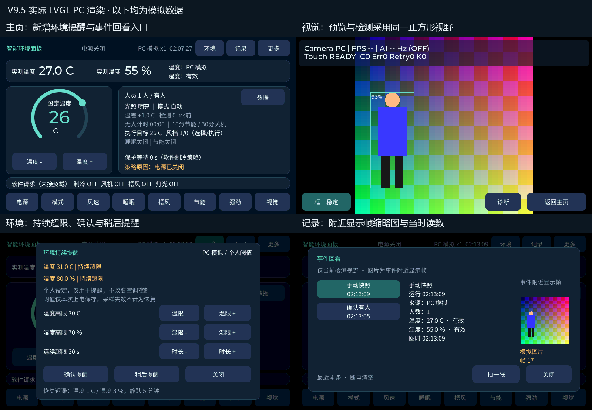

# V9.5：一致的检测视野、环境持续提醒与事件回看

日期：2026-10-12。基于 V9.4，已完成 PC 验证和板端全量编译，**尚未烧录**。开发板最后一次用户验收的版本仍为 V9.3。

这轮增加的是能观察和回看的信息：相机看到的区域与检测区域一致；环境持续超限时给出个人提醒；人员状态变化和环境提醒可以回看当时读数与附近图片。没有增加固定摄像头分区。

## 效果与操作

以下为实际 LVGL / SDL 预览程序输出，**全部使用 PC 模拟数据与模拟图像**：

主页右上新增 **环境** 和 **记录**。原有更多设置、温湿度读数、圆环、控制按钮、数据曲线和视觉诊断继续使用。

### 视觉：画面与检测视野一致

IMX335 的 2592×1944 图像沿用模型原有的中心正方形区域 `(324, 0, 1944, 1944)`。推理输入仍为 224×224，Tiny YOLO v2 模型及其预处理不变；显示支路改为同一区域的 480×480 图像，在 800×480 LCD 的 x=160 处居中呈现，两侧保留黑边。

人体框映射到 x=160～639、y=0～479。屏幕与模型使用一致几何范围；这不是新增分区，也不表示能检测画面之外或房间里被遮挡的人。该支路的实际摄像头启动、帧率与画质还需更新后实板确认。

保持原来的 800×480 RGB565 背景缓冲、LTDC 背景层、三缓冲所有权和 VBlank 交接。DCMIPP 显示宽度为 480，行步长为 1600 字节，写入每行的中央区域；配置后核对 pitch 寄存器。前景 ARGB4444、20 行绘图缓冲和 M55 转换继续使用。

### 环境：持续超限才提醒

**环境** 弹层显示温湿度状态，可分别调高限，以及持续确认时长。默认规则：

| 项目 | 默认触发 | 恢复条件 |
|---|---|---|
| 温度 | ≥30°C，连续 120 秒 | ≤29°C |
| 湿度 | ≥70%，连续 120 秒 | ≤67% |

可调温度高限 16～40°C、湿度高限 30～95%、持续时长 30 秒～30 分钟。温度与湿度分别计时，任一通道失效不会阻止另一通道工作。

- **确认提醒**：标记已经看过，仍显示超限，不把确认当作环境恢复。
- **稍后提醒**：静默 5 分钟；仍超限时恢复提示，不重复生成同一次超限事件。
- 新鲜采样失效或过期：尚在确认的计时清零；已触发的提醒保留并标注采样不可用，不记录假恢复。
- 更改阈值或来源会重建确认会话，不继承原来的持续时间。

这些是个人设定的温湿度范围，不是医疗或空气质量评估。提醒只显示与记录，**不改变原来的气候控制请求**。阈值和确认状态仅保存在 RAM，断电或复位后恢复默认值。

效果：[持续确认](images/v9-5/environment_pending.png)、[持续超限](images/v9-5/environment_active.png)、[已确认](images/v9-5/environment_ack.png)、[采样失效但保留提醒](images/v9-5/environment_unknown.png)。

### 记录：最近四次事件与图片

**记录** 打开事件回看；左侧选择记录，右侧展示事件类型、上电时间、来源、当时人数及温湿度、图片帧号与采集时间。**拍一张** 保存当前读数和可用画面的缩略图。

自动记录：首次确认有人／无人、后续确认状态变化、温度／湿度持续超限及恢复。短暂 AI 故障显示未知，不凭空记录无人；恢复后仍为原状态时也不重复记录。人员变化只针对当前检测视野，不识别身份，不等同于全房间进出。

最近 **4 条**使用固定环形记录，每条配 128×128 RGB565 图片。第五条覆盖最早记录；若正在查看的记录被淘汰，明确提示重新选择，不用错位后的列表行冒充原图。缩略图总容量为 **128 KiB 外部 RAM**，没有把图片放进 LVGL 堆，也没有写 Flash 或 SD 卡；断电即清空。

图片来自事件附近、已经提交给 LCD 的显示帧，**不是该次推理的精确输入帧**。超过 500 ms、相机不可用、复制失败时保留事件并明确显示无图；连续点击同一冻结帧不保存成新照片。复制期间暂时固定背景缓冲所有权，不关闭整个复制过程的中断；停机或恢复期间的旧缓冲不能冒充新鲜画面。

实板采样、PC 模拟和演示回放分别标明来源，切换来源清空原会话记录；PC 图片不能带进实板来源。时间为上电经过时间，不是日历时间。

效果：[图片与读数](images/v9-5/journal.png)、[所选记录被淘汰](images/v9-5/journal_evicted.png)、[无可用图片](images/v9-5/camera_unavailable.png)。

## 模块与资源

| 模块 | 责任 |
|---|---|
| `app_camera_geometry.h` / `app_camera.c` | 正方形显示范围、行步长和框坐标映射 |
| `app_lcd.c` / `app_ui_port.h` | 固定新鲜显示缓冲并采样缩略图；PC 使用相同端口 |
| `app_environment_alert.c/h` | 无 LVGL / HAL 依赖的双通道提醒状态机 |
| `app_event_journal.c/h` | 固定容量元数据与外部图片池、稳定 ID 和来源会话 |
| `app_ui_environment.c/h` / `app_ui_journal.c/h` | 复用的环境设置和事件回看弹层 |
| `app_ui.c` / `app_ui_lifecycle.h` | 单 UI 线程快照观察、弹层入口和只读测试接口 |

LVGL 公共内存池由 **96 KiB 调整为 160 KiB**。新增弹层常驻后，96 KiB 在完整集成测试中发生绘制任务分配失败，定位后提高配额，并重新完成所有 PC 检查及板端编译。增加 64 KiB 是新功能的资源预算，不是内存节省或帧率提升。

完整 PC 测试：分配器可用总量 148,736 字节，峰值 86,880 字节，结束时空闲 64,216 字节，最大连续空闲块 64,056 字节；堆完整性正常。这些不是整颗 MCU 的 RAM 用量，也不能推算实板 FPS、AI Hz 或 CPU 使用率。

中文字体覆盖 385 个源文案字符，生成检查通过。板端新增四个模块均实际链接；内部 RAM 分配末端 `0x34065518`、外部 RAM 分配末端 `0x91413000`，均在原有区域内。图片池地址 `0x913F3000`，大小 131,072 字节。

## 验证与固件

**42 项工程检查、383 项完整 PC 界面断言全部通过**；保留 V9.4 的 326 项断言，新增 57 项。覆盖真实鼠标设置、阈值边界、持续计时、确认／静默、过期与独立湿度有效性、来源隔离、真实回放入口、图片 RGB565 显示、相机无图／恢复／冻结帧、稳定 ID 与淘汰、模态遮罩、诊断滑动、旧曲线与按钮、退出和堆完整性。

图片检查从保存的 RGB565 缓冲取样，与实际合成画面核对，100/100 个像素匹配。9 张新增页面截图完成视觉检查，未发现缺字、文字截断、按钮或图片重叠。纯环境与记录测试还覆盖时间回绕和大量环形记录操作。

板端最终目录：`build/firmware/lifecycle_20261012_v9_5_final2/`。**545 个源文件全部新编译并链接**，1,531 项当前输入指纹一致，无旧对象复用、输入变化或未定义符号。独立核对 HEX 校验和、连续地址、BIN 字节及 ELF ROM 段，三种内容一致。

| 属性 | 值 |
|---|---|
| 应用 BIN 大小 | 644,352 字节 |
| 起点／末字节 | `0x70100400` / `0x7019D8FF` |
| 模型起点／剩余间距 | `0x70200000` / 403,200 字节 |
| `text / data / bss` | `643484 / 844 / 4686268` |
| BIN SHA-256 | `2b7707fd9b137ecb71a33ef21879eafef2cc700a9ce86af0d3ad1f8ae4e18ea1` |
| HEX SHA-256 | `ad209387d4f0014c200fca26ae64825b29b91c80d873151e2a082618a7d18884` |

证据目录：`D:/Learning/AC-N647/tmp/lifecycle_20261012_v9_5/`。汇总 `verification.json`；工程检查 `test-results.json`；最终完整日志与 BMP 为 `preview_final3/`；编译日志 `build-final2.log`；独立产物复核 `artifact-review-final.json`。失败过程保留，`final` 旧固件及 `preview_final2` 失败结果不作为最终交付。

## 查看与上板验收

VS Code 打开 `simulator/lvgl-preview.code-workspace`，按 F5 选择“PC 界面预览”。主页点环境，用 `T` / `H` 提高模拟读数，`F` 可加速计时；点记录查看，`0/1` 改变模拟人数后等待确认。模拟器不连接开发板。

上板后先确认 DHT11 正常、触摸正常；进入视觉确认中央正方形画面、框位置、实时 FPS / AI Hz，以及展开诊断连续滑动。再从主页点环境，将个人温度高限调到略低于当前正常实测值、持续时长调到 30 秒，观察确认与提醒；点记录核对实际缩略图，连续拍五张测试四条容量。测试完成恢复所需阈值。

**本轮没有烧录，也没有声称上述新增硬件路径已实板验收。** 修改需要更新应用后生效；实际帧率、UI 响应、缩略图采集耗时和长期稳定性还需实板测量。
