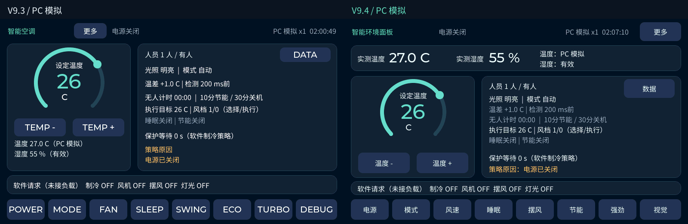

# V9.4：LVGL 公共主题、中文交互与环境读数

日期：2026-10-12。

本轮针对 V9.3 的整个 LVGL 应用层整理：主页、视觉、数据、演示和控制弹层共同使用主题与控件工厂。新版已完成板端全量编译，尚未烧录；开发板目前运行用户已验收的 V9.3。

## 直接可见的变化

以下为真实 LVGL PC 渲染的前后对比，均为模拟数据：

- 主页顶部独立显示 32 px 温度、湿度，旁边显示采样状态；目标温度仍使用圆环和 48 px 数字。
- 大读数失效时使用缺失符号或明确标注“上次温度／湿度”，缓存值和异常提示使用警示色；温度、湿度质量分别处理。
- 操作统一中文：电源、模式、风速、睡眠、摆风、节能、强劲、视觉；数据页导航为主页、视觉、数据、演示。
- 常用入口和曲线返回按钮达到 44～48 px 高度。按下只改变颜色，不放大控件；当前页面与控制选择使用一致选中样式。
- 底栏和三个设置面板使用 Flex 排版。面板在风档单行、双摆风单行、更多两行之间复用，不重建按钮。
- 人员的暗光状态显示“暗光有人”，让光照推断的含义更清楚；自动睡眠控制策略仍按原规则执行。

## 参考与版本适配

已读取飞书《4、LVGL应用编程》的对象、盒模型、事件、共享样式、Part／State 和字体章节。[原教程](https://x509p6c8to.feishu.cn/docx/Jzd3dlsq5oSTSRxyBbccIagDnSe)

第二篇《LVGL源码分析》只读到公开目录，子章节需要登录，未将其称为已阅读正文。用户随后指定中文开发手册，参考入口为 [LVGL 中文手册](https://lvgl.100ask.net/master/index.html)。

实施时以本工程 LVGL 9.2.2 的源码与固定版本官方文档核对：共享样式可跨对象复用，样式必须保持有效生命周期；状态与继承决定按钮及文字的反馈。[官方样式说明](https://docs.lvgl.io/9.2/overview/style.html)

Flex 用于操作行，固定图表尺寸和相机框坐标继续由各页面管理。[官方 Flex 说明](https://docs.lvgl.io/9.2/layouts/flex.html) 中文手册相应章节为 [样式](https://lvgl.100ask.net/master/details/base-widget/styles/index.html)、[弹性布局](https://lvgl.100ask.net/master/details/base-widget/layouts/flex.html)、[滚动](https://lvgl.100ask.net/master/details/base-widget/scroll.html) 和 [字体](https://lvgl.100ask.net/master/details/main-components/font.html)。`master` 中的接口以当前库实际支持为准。

## 实现与维护

| 模块 | 责任 |
|---|---|
| `app_ui_theme.c/h` | 颜色、静态共享样式、屏幕／卡片／标签／按钮／Flex 行工厂 |
| `app_ui.c` | 主页、视觉页、输入回调、显示提交与刷新调度 |
| `app_ui_controls.c` | 持久控制弹层、选项布局、偏好与执行限制说明 |
| `app_ui_insights.c` | 数据和演示页面、历史曲线与只读详情 |

初始化文案使用静态字符串或模块持久数组；运行期临时格式化文字由 `app_ui_theme_text()` 复制，仅在内容变化时更新。控制弹层继续使用自己的固定文字缓冲。

按钮取消默认主题的尺寸过渡，共享 `DEFAULT / CHECKED / PRESSED / CHECKED+PRESSED / DISABLED` 样式；文字继承父按钮状态颜色。控件不自行 CHECKABLE 切换，控制快照决定选中状态。

普通卡片和文字为被动对象；图表卡片明确可点击，诊断面板明确可点击且可纵向滚动，弹层遮罩接收触摸。修改样式时需同时检查这些交互属性。

显示移植沿用单个 LVGL 显示对象、单 UI 线程、20 行双 ARGB8888 绘图缓冲、ARGB4444 转换与原 LTDC 前景／相机背景交接。检测框按新帧更新，普通信息约 200 ms，诊断详情约 1 s；按住和滚动期间的长诊断冻结继续有效。

## 验证与资源

40 项工程检查已通过。最终 **326 项完整 SDL 自测全部通过**，保留原有 272 项，并新增 54 项：真实按下／松开像素反馈、边缘触摸、Flex 排列、选中状态、曲线卡片标题／边缘点击、禁用操作和独立大读数故障显示。按钮、曲线、事件、透明像素、人体框、诊断滚动和堆完整性仍正常。

同一组原有完整 PC 测试负载的比较：

| LVGL 分配器统计（字节） | V9.3 | V9.4 首轮 |
|---|---:|---:|
| 峰值使用 | 79,216 | 69,352 |
| 检查时空闲 | 12,168 | 19,168 |
| 最大空闲块 | 6,400 | 19,136 |

两版均使用相同 96 KiB LVGL 配额。分配器报告的可用总量受元数据占用影响；这些是 PC 测试结果，不代表 MCU 全部 RAM 使用、实测 FPS 或 CPU 使用率。新增 54 项后，最终完整负载报告峰值 69,472、空闲 19,032、最大空闲块 18,928 字节；堆完整性与诊断文字替换余量检查通过。

最终日志：`D:/Learning/AC-N647/tmp/lvgl_20261012_v9_4/preview_final2/self-test.log`。首次新增布局检查暴露测试定位器从底层主页选中了与弹层同名的“强劲”按钮，测试定位已改为按绘制顺序查找顶层可见控件；失败日志保留在 `preview_final/`，未弱化布局断言。

效果图：[更多设置](images/v9-4/more.png)、[数据页](images/v9-4/data.png)、[曲线详情](images/v9-4/temperature_detail.png)、[DHT11 失败与缓存](images/v9-4/dht_last_good_failure.png)、[视觉模拟预览](images/v9-4/vision.png)。

中文子集覆盖 331 个实际所需字符，新增 Montserrat 32 用于数字；未引入完整中文大字库。相对 V9.3，应用增加 47,168 字节，BSS 增加 200 字节；其中 Montserrat 32 的已链接 ROM 段为 45,861 字节。

## 板端产物

最终目录：`build/firmware/lvgl_20261012_v9_4_final2/`。

541 个源文件重新编译并链接，1,522 个源码／头文件／构建配方输入指纹，88 个平台不适用源排除；未复用旧目标文件，编译期间输入未变化。

| 属性 | 值 |
|---|---|
| 应用大小 | 627,744 字节 |
| 起点／末字节 | `0x70100400` / `0x7019981F` |
| 模型起点 | `0x70200000`，应用未越界 |
| `text / data / bss` | `626876 / 844 / 4488020` |
| BIN SHA-256 | `7602d5e87e54cf989a73cd641e29680165480fcf766d9dd7e51774ade5aa1d71` |
| HEX SHA-256 | `acf08a39ef745352698e7bcbdaaedbe9187829169358de3917414decc71b0ba9` |

第一次构建在会话中断后未完成，保留在 `lvgl_20261012_v9_4_final/`；仅使用上面的 `final2` 成功产物。

证据目录：`D:/Learning/AC-N647/tmp/lvgl_20261012_v9_4/`，含修改前文件备份、工程检查结果、完整预览日志／截图、最终编译日志与独立产物复核；汇总为 `verification.json`，独立复核为 `artifact-review.json`。当前 1,522 项输入指纹与产物仍匹配，BIN／HEX／ELF 内容与哈希验证通过。新版尚未烧录，硬件触摸、摄像头和长期运行效果需更新后验收。

## 预览与后续验收

使用 VS Code 打开 `simulator/lvgl-preview.code-workspace`，按 F5 选择“PC 界面预览”，即可查看新版。窗口为模拟数据。

上板后需检查顶部温湿度与 DHT11 状态、风档／摆风／更多设置、数据页点击卡片与拖动读数、视觉页框切换，以及展开诊断连续滑动。实板 FPS／AI Hz 应从顶部实测读数记录，不能由 PC 结果推断。
