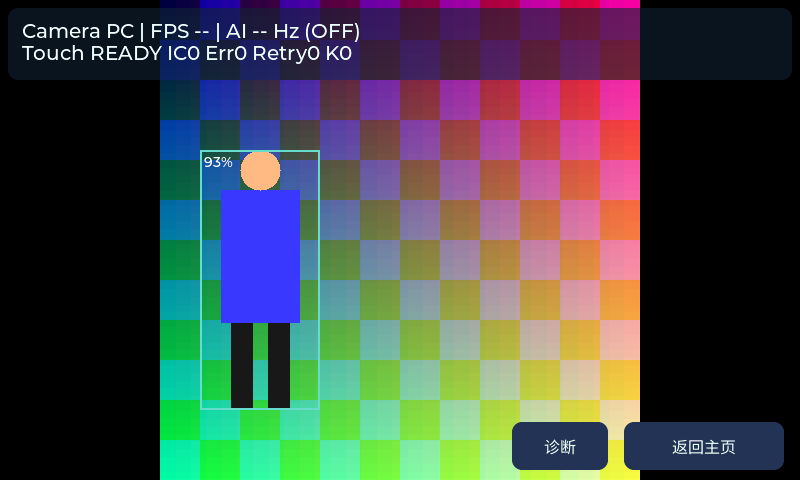

# V10：YOLOv8n 人体模型与精简摄像头预览

完成日期：2026-10-13。已完成模型转换、代码接入、板端编译和 PC 验证，**尚未烧录**。最后一次用户验收的实板版本仍为 V9.3。

## 本轮变化

当前源码已从 Tiny YOLO v2 切换到 **YOLOv8n 人体单类 INT8、256×256**。不是从零训练的新模型；采用 ST 模型库引用的已量化 COCO-Person 模型，并固定来源 commit 与 SHA-256。[ST 模型说明](https://github.com/STMicroelectronics/stm32ai-modelzoo/blob/main/object_detection/yolov8n/README.md)

| 接口 | 原 Tiny YOLO v2 | 当前 YOLOv8n |
|---|---|---|
| 输入 | UINT8 RGB，224×224×3 | UINT8 RGB，256×256×3 |
| 单输入缓冲 | 150528 字节 | 196608 字节 |
| 输出 | FLOAT32 `[1,7,7,30]`，5880 字节 | FLOAT32 分面 `[1,5,1344]`，26880 字节 |
| 后处理 | 5 anchors、245 候选 | 已解码归一化中心框、1344 候选 |
| 结果上限 | 10 个 | 10 个 |

模型权重仍为 INT8；应用的输入是 UINT8，输出经模型解码为 FLOAT32。输入量化 scale≈1/255、zero point=0，输出中心／宽高已经归一化，后处理不再次除以256。

256 是本轮正式编译配置；320 候选已下载并通过真实 TFLite 合成输入检查，尚未接入或编译为本次实板固件。当前阈值0.5、NMS IoU0.45是候选默认值，还没有本机场景校准依据。

按用户要求，摄像头预览删除 **“框：稳定／原始”切换按钮、YOLOv8 型号和输入尺寸常驻文字**。人体框默认继续使用稳定绘制，FPS、AI Hz、触摸摘要及“诊断／返回主页”保留；模型详情只在展开诊断后查看。

以下为实际 PC 界面渲染，图像与检测结果均为模拟数据：



## 迁移与保护

- 运行库更新为 `ll_aton 1.1.3-dev275` 和 `NetworkRuntime1201_CM55_GCC.a`，保留本板 HAL、ThreadX、缓存时钟、FSBL及外部加载器。修正新库重复的 CACHEAXI MSP 定义，继续用原板级实现。
- 新运行库显式采用单网络 `APP_HAS_PARALLEL_NETWORKS=0`；17个运行库源与排除项记录在 `Middlewares/AI/Npu/runtime-build.json`，构建脚本使用当前清单及新库，RTOS被包含的C模板也纳入指纹。
- 统一 `app_postprocess_params_t`，不再把NN工作线程写死为YOLOv2；保持采集／输出双缓冲、缓存维护、有限等待和恢复前的线程确认。
- 启动前核对生成网络的尺寸、类型、物理内存布局、量化参数和实际缓冲容量，随后校验外部Flash中完整模型权重CRC。旧权重与新应用不匹配时报告 `-1210`，放行触摸启动，并停止相机／NPU启动。
- V8后处理检查概率、有限坐标、尺寸及候选容量；允许正常越界框，由显示映射裁剪。贪心NMS选满10个结果后提前结束，保留排序与原有结果语义。
- 256正方形输入继续使用原有中心裁剪，V9.5的480×480预览及映射范围不变；没有重新增加固定摄像头分区。

标准生成入口为 `scripts/generate_model.py`，原 `Model/generate-n6-model.sh` 已调用该脚本。它根据公共模型配置选择固定来源模型、检查生成I/O、保存覆盖前文件、同步网络文件／权重／CRC／bundle；生成后须重新编译应用。

本机ST转换工具缺少部分Python源模块和Crypto本地库，已在任务目录使用自带Python缓存与同版本PyCryptodome3.17补齐，未修改全局Python或ST安装目录。复用时可执行：

```powershell
python scripts/generate_model.py --tool-overlay D:/Learning/AC-N647/tmp/model_upgrade_20261012_v10/tool_overlay
```

该入口已实际完成最终生成。证据位于 `build/model-generation/v10_release_20261013/`；SDK版本为ST Edge AI Core4.0.1。来源、许可证入口与模型SHA保存在 `Model/candidates/provenance.json`；生成产物及权重指纹保存在 `Model/model-bundle.json`。

## 验证及实际边界

**45项工程检查、389项最终PC界面断言全部通过，另有完整模型bundle核验通过。** PC检查包括按用户要求删除两类常驻控件、稳定绘制与透明清除、模型错误诊断、所有原有控制与数据页面、退出和堆完整性。原测试的“raw模式坐标”检查随已删除的交互替换为稳定框的及时更新／抖动和边界检查；没有关闭稳定绘制。

实际TFLite模型256／320各执行黑、白、渐变、固定随机四种输入，并重复运行检查一致性。真实256输出经过生产后处理，未发现布局或有限数值问题。这些是接口检查，不能用来宣称人体检测准确率提升。

V8后处理两种候选读取路径各288816项断言通过，含1200组随机、多类、同分、密集对照和边界守卫；原V2的4700组参考对照继续通过。1344个不重叠高分候选场景，IoU比较由902496次降为13385次，结果逐位相同；没有测量板端耗时或Hz改善。纯模型合同／CRC在O0、O2各13142项断言通过。

最终LVGL分配器峰值86232字节、空闲65008字节、最大连续空闲64848字节，配额160KiB，堆完整性正常。模型编译报告的activation汇总为638976字节，各实际与虚拟NPU内存池均在所配区域内；虚拟池与物理子池覆盖同一组bank，不能重复相加。

**本轮没有实板准确率、FPS、AI Hz、权重CRC执行或长期稳定性结果。** 升级后要比较同一批远处、坐姿、遮挡、多人和空场景，记录误检／漏检、人数错误以及NN／PP／Frame／Drop；还需回归触摸、DHT11、摄像头、诊断滑动和事件缩略图。PC预览仍不运行真实摄像头或NPU。

## 配套烧录文件

最终目录：`build/firmware/model_20261013_v10_final2/`。**应用和权重必须配套更新**：

| 文件 | 地址 | 有效载荷大小 |
|---|---|---:|
| `appli.hex` / `appli.bin` | `0x70100400` | 836128 字节 |
| `network-data.hex` / `network-data.bin` | `0x70200000` | 3011681 字节 |

543个源文件全部新编译、1543个当前源码／头文件／配方／库输入指纹一致，零未定义符号；应用HEX、BIN与ELF独立解析内容一致。应用末地址 `0x701CC61F`，距模型分区剩211424字节；权重末地址 `0x704DF460`，完整CRC32为 `0x4D999695`，BIN与HEX全部字节匹配。

应用BIN SHA-256：`de37af06e0eeb5d3c297ce45fafd8d13e21c14b4d8343bbef3b561e50c1b22ad`。
应用HEX SHA-256：`dc77122bb8e592a45a33a144caa5c0de587c2092ed7f3a764e41e06b07791d69`。
权重BIN SHA-256：`b6e81e4337aae81d38243f5423d9c0d81bf9f9bf616432153385a0cefad9aa96`。

`release-model.json`记录该应用／权重组合与验证结果；`rollback-v9-3/`包含原V9.3应用和Tiny YOLOv2权重，供配套回退。原FSBL不变。本轮未连接烧录工具或写开发板。

证据目录：`D:/Learning/AC-N647/tmp/model_upgrade_20261012_v10/`。汇总为 `verification.json`，最终产物复核为 `artifact-review-final.json`，模型核验为 `test-model-bundle.json`，界面最终日志／BMP为 `preview_clean1/`；备份为 `backup_root/`、`backup_runtime/`。`candidate1` 和 `model_20261013_v10_final` 的旧布局产物已被本版替代，不用于交付。
