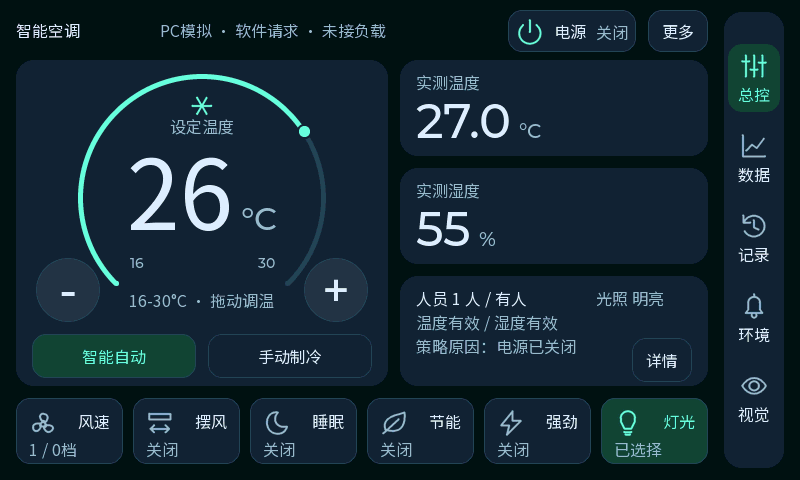

# V12 Bento 首页与调温交互

此页保留原深色稿的实现与验证记录。用户随后表示更喜欢V11鲜艳配色，最新源码在保留此布局与交互改进的基础上恢复波浪和亮色传感器卡，见[鲜艳融合稿](ui-bento-vivid-20261014.md)与[三版实际对比](design/bento-vivid-20261014/index.html)。

2026-10-14。用户反馈底部文字不一致、加减偏小、希望恢复拖环，要求参考Bento风格并改善图文适配。用户确认深色蓝灰＋薄荷绿配色，查看实际LVGL后选择采用当前布局；随后询问与现有V11的区别。

这是保留操作骨架的视觉与交互改造。主数字96、单位32、原功能入口和控制策略保留；更明显的变化在背景、语义分组、文字基线、图标与触摸尺寸。[实际前后对比](design/bento-20261014/index.html)可以切换旧版、新版或拖动查看。

## 四项改动

| 用户问题 | 原因与本次处理 |
|---|---|
| 下方文字大小不一 | 原六个主标签实际均为Noto16，风速／摆风多一行Montserrat14状态且标题y8，其余只有一行标题y17；现全部同Noto16、同位置的名称和状态两行 |
| 加减小、需要拖环 | 加减49×49改64×64，符号用已有48字号；圆环增加触摸带和拖动能力，8px移动门槛防轻点跳温 |
| 风格不协调 | 去除波浪与大面积荧光块；统一蓝灰背景、卡片圆角和间距，主温控、实测温度、湿度、环境状态各自成组 |
| 图标失真、图文不适配 | 14个图标24改28原尺寸A8，统一2px线宽，简化风扇／摆风／雪花，按轮廓中心对齐；图标与汉字留10px间隔，六标题同基线 |

源框架没有更换。灰蓝底与图标经既有ARGB8888→ARGB4444前景转换；颜色仍有硬件格式的量化，但使用平面底和较稳的2px线条改善小尺寸识别。没有启用SVG、PNG、Lottie或新绘图线程。

## 分组与保留功能

主温控卡为372×326，容纳252px圆环、设定读数、64px加减和44px模式按钮。右侧两个308×96实测卡采用同一读数规则，单位与数字靠近并按基线对齐；下方308×110状态卡集合人员、光照、采样质量、原因和详情。底部六项107×66，等间距、同字号、同图标尺寸。右侧导航保持总控、数据、记录、环境、视觉。

全部既有控制、风档和双向摆风选择、提醒设置与确认、照片事件、曲线放大／取点、PC演示、摄像头人体框及诊断保留。人工与自动睡眠／节能在状态行分开说明；执行风档与选择风档仍在状态和详情中区分。未接负载说明保留，不把图标选中当作实物已运行。

## 拖动实现与边界

`app_ui_temperature_input.c/.h`只由LVGL所有者调用，使用原TEMP_UP／DOWN动作。每次新控制器快照发布时同步输入游标，连续事件按游标提交，避免重复基于200ms旧界面快照计算差值。PC演示被手动操作中止后，先恢复偏好，应用本次动作，再发布最终状态，避免再入旧值。

圆环保留0～270的细粒度视觉角度以支持短过渡；真实拖动四舍五入映射为16～30℃。轻点、轻微抖动、中心／缺口、人工VALUE_CHANGED和显示动画不提交温度动作。手指释放与切页取消手势并恢复可信值；拖动过程中只编辑设定值，执行状态仍来自真实快照。

## 验证与固件

- PC完整自检438项通过，0项失败，包括原业务、数据有效性、透明叠层与图表，以及连续来回拖环、未发布快照的快速加减、同点停留、边界、外部调温重同步、窗口外释放、动画无额外动作和弹层不击穿。
- 六控件标题与状态均同Noto16、相同行框、28×28原尺寸A8图标；几何检查发现并修复了工厂caption继承CENTER对齐造成的偏移。
- LVGL堆峰值106312B，结束空闲46136B、最大连续46000B，完整性通过。
- 546个板端源文件全量重新编译、链接通过，无未定义符号；392字符中文字体和图形生成一致性通过。
- 应用872736B，末地址`0x701d551f`，与模型起点间隔174816B；未引用的48000B波纹像素已被链接回收。配套模型保持V10／V11相同权重，SHA与完整模型绑定检查通过。
- 7项显示／启动／线程契约检查通过，CubeIDE linked resources XML通过解析。

最终目录 `build/firmware/ui_bento_20261014_final/` 包含应用、原配套模型、`manifest.json`与`release-ui.json`。PC截图和完整日志在 `D:/Learning/AC-N647/tmp/ui_bento_20261014/pc-03/`；打包与契约证据在 `D:/Learning/AC-N647/tmp/bento_ui_20261014/`。

本轮尚未烧录。开发板当前仍运行已验收主页／触摸／摄像头的V11。PC鼠标回归不能代替新版手指拖环的实板验证，也不代表模型帧率或准确率。

## 参考的范围

用户给的 [微信文章](https://mp.weixin.qq.com/s/a6V4au_Fk69wegKNl8shbg)公开访问返回安全验证页，没有读到正文；本实现不声称复述该文。

公开参考为 [Apple Home app](https://www.apple.com/home-app/)、[Material 3布局示例](https://m3.material.io/foundations/layout/canonical-examples/overview)及[Material卡片说明](https://github.com/material-components/material-components-android/blob/master/docs/components/Card.md)。据这些资料与本工程作设计推导：按主题分组内容和操作、区分主区域与辅助区域、使用统一网格与卡片规则；未复制联网设备功能或外部素材。
