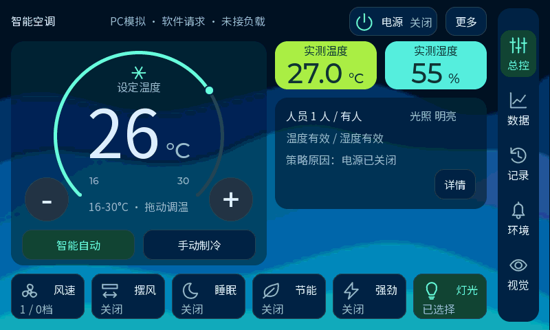

# V12 温湿度并排小卡与大读数

2026-10-14。用户认可亮绿温度、青色湿度与增强蓝色波浪，要求温湿度卡占地更小。经过70px上下卡和缩宽预览后，用户进一步指定并排成一行，并放大读数。当前源码采用两张148×70px小卡、40px读数与20px单位。

[实际LVGL前后对比](design/bento-compact-20261014/index.html)可以切换原大卡、并排32px读数和最新40px读数；拖动模式直接比较原大卡与最新稿。[前版鲜艳融合记录](ui-bento-vivid-20261014.md)保留旧图和固件信息。

## 布局与读数

| 项目 | 原鲜艳大卡 | 当前并排小卡 |
| --- | --- | --- |
| 每张温湿度卡 | 308×96px | 148×70px |
| 排列 | 上下两张 | 一行两张，12px间隔 |
| 两张卡总色块面积 | 59136px² | 20720px²，减少约65% |
| 数字字号 | 48；首次并排预览32 | 最新40，比并排初稿增大25% |
| 单位字号 | 20 | 20，与数字共用基线 |
| 下方环境状态 | y276、110px高 | y142、162px高，原信息按32px行距排列 |

小卡位于右列x400／560、y60。标题使用既有中文16px字体，放在卡内y1、居中；数字放y25，按实际数字和单位宽度居中，二者共享卡内基线61。正常值、`--`和“上次温度／湿度”各自保留正确显示。

仓库现有Montserrat40字体由`lv_conf.h`启用，板端与PC共用配置；无需下载字体。数字实际墨迹到卡内y60，底部仍约9px留白。按字体字宽与字距核算，DHT11温度0～50℃最宽组合121px；扩展−50～80℃最宽137px；湿度100%组合94px，均能放入148px卡片。

主设定温度96px、单位32px、64px加减与拖环继续保留。环境状态上移后，右下方露出静态蓝色波浪。风速、摆风、睡眠、节能、强劲、灯光和数据／记录／环境／视觉／诊断功能继续保留。

## 验证与状态

最新PC完整回归438项通过，0项失败，覆盖原业务、页面切换、实际鼠标拖环、温湿度独立失效、DHT11缓存值与正常退出。正常、全部缺测及仅湿度无效图片经视觉检查，标题、数字、单位没有重叠或裁切。原测量读取查找和字体断言随读数更新到40；并排断言检验同一行内独立读数，保留原业务检查。

LVGL堆峰值114968B，结束空闲45784B、最大连续45648B，堆完整性与诊断替换空间通过。UI接口和正式页面契约、392字符中文字体一致性检查通过。

板端546个源文件全量重新编译、链接通过，1549个构建输入指纹保持一致，无未定义符号，HEX与BIN逐字节一致。应用991232B，起点`0x70100400`、末地址`0x701f23ff`，与模型起点`0x70200000`间隔56320B。启用40字号增加只读Flash，原160KiB LVGL堆配置保持；没有新增全屏缓冲。最终证据由固件目录中的`manifest.json`与`release-ui.json`记录。

最新固件目录为`build/firmware/ui_bento_compact_row40_20261014_final/`，含应用HEX／BIN、配套模型和发布验证记录；应用BIN SHA256为`10741743c796c5e17bd7fb5415a328f95d23dac1da3a5633e066e651c05f79d7`。配套模型与V11保持相同，复制后SHA核对一致。PC构建日志、完整自检与原生BMP在`D:/Learning/AC-N647/tmp/bento_compact_20261014/pc-row40/`；前几次预览分别存于同目录的`pc-final2`、`pc-width`与`pc-row`，没有用旧截图代替最终渲染。

打开`simulator/lvgl-preview.code-workspace`并按F5可交互预览当前源码。本稿已于2026-10-15烧录并完整回读校验，用户已确认Flash启动后新界面、调温、触摸和摄像头正常；PC图继续使用模拟数据。

## 2026-10-15 实板烧录记录

本次只更新应用；板上模型与发布配套模型逐字节一致，没有重写。外部Flash的应用受影响范围`0x70100000～0x701F3000`已完整备份995328B，写入时保留应用前1024B和末尾3072B；下载工具校验与独立完整回读均通过，应用991232B与发布BIN逐字节一致。模型3011681B及完整3014656B扇区范围、FSBL32768B写前写后保持一致，没有全片擦除。

前两次重连在读取核心ID阶段失败，均未进入擦写；彻底断电后第三次连接恢复，在同一次连接中完成备份、应用写入和完整回读。连接恢复的具体电气原因尚未确定。

[完整烧录与回读结果](D:/Learning/AC-N647/tmp/ui_bento_flash_20261015_row40/attempt_03/flash-result.json)。备份、下载参数、完整日志与独立回读文件同目录保留。用户随后将BOOT0、BOOT1均接GND并重新上电，已确认新界面、调温、触摸和摄像头正常。此确认覆盖上述实板功能，不代表新增AI准确率、推理更新率或长时间稳定性测量。
