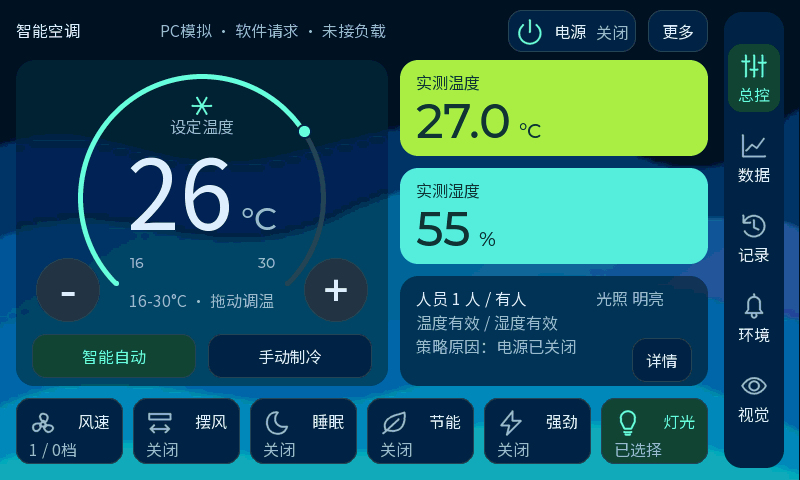

# V12 Bento 鲜艳融合稿

此页保留原鲜艳大卡稿的记录。用户随后要求温湿度卡变小、并排成一行，再放大读数；最新源码与预览见[并排小卡与大读数](ui-bento-compact-20261014.md)，旧色彩与背景继续沿用。

2026-10-14。用户接受Bento分组布局后表示“旧V11可能还更艳丽一下，比较符合审美”。当前源码因此恢复V11的颜色和静态波浪，保留已完成的字号、图标和调温交互改进。看到融合稿后，用户进一步要求“背景蓝色波浪可以艳丽一点”，最新资源只加强波浪颜色。本稿已提供实际LVGL预览，尚未烧录。

[旧V11／深色Bento／鲜艳融合稿交互对比](design/bento-vivid-20261014/index.html)使用三版真实渲染图，可直接切换，也可拖动比较旧版与融合稿。原深色稿的记录和固件保留在[原Bento实现记录](ui-bento-20261014.md)，没有覆盖旧构建。

## 色彩与层次

- 温度卡恢复亮绿`#A3ED49`，湿度卡恢复青色`#59EDDE`，读数与单位统一深色`#143C3B`。
- 静态蓝色波浪由已有200×120 RGB565图像以4倍显示，仍使用原生资源。主温控卡背景60%不透明、环境状态卡80%，文字和图标保持不透明。
- 波浪加强稿保留深色顶层，提升中段蓝色与底部青色的亮度、饱和度；资源生成前后已核对，仅背景像素数组变化，数字、图标和资源尺寸逐字节不变。
- 底部功能与右侧导航保持深色，重点色仍为薄荷绿。鲜艳色集中于两张实测卡，主设定读数继续白色。
- 未更新或失效的测量卡变灰、数值显示`--`，保留采样错误和缓存有效性提示；不会因为颜色变亮而把旧数据显示为正常。

## 保留的操作改进

布局继续采用已确认的Bento分组：主温控、实测温湿度、环境状态、六项操作和五个导航。加减为64×64，圆环支持16～30℃拖动调温，轻点和轻微抖动不调温。主数字96与单位32共享基线；底部六项名称和状态同Noto16；14个28px原尺寸A8图标保持统一2px线宽。

原业务与页面继续保留，包括风档和双向摆风、睡眠、节能、强劲、灯光、曲线取点、历史事件、环境提醒、视觉人体框、DIAG和PC演示。控制请求仍是软件请求，没有连接实际负载。

## 验证结果

PC完整自检438项通过，0项失败，覆盖原功能、数据有效性、透明叠层、连续拖环、快速加减、外部调温重同步、边界与正常退出。LVGL堆峰值114928B，结束空闲45824B、最大连续45688B，完整性及诊断替换空间检查通过。实际首页、两项无数据和仅湿度无效截图经视觉检查，无阻断问题。

板端546个源文件全量重新编译和链接通过，1549个源／头／构建输入指纹未变，无未定义符号，HEX与BIN逐字节一致。图形资源及392字符中文字体生成一致性检查通过；透明像素保留与显示基线检查通过。

应用920928B，起点`0x70100400`，末地址`0x701e115f`，与模型起点`0x70200000`间隔126624B。恢复波浪后比深色稿增加48192B，其中原波浪像素48000B重新进入Flash；没有新建全屏绘制缓冲。实际显示帧率和手指拖环体验仍需实板验证。

配套模型与已烧录V11保持相同，完整TFLite／生成代码／输入输出／权重BIN、HEX与CRC绑定检查通过，打包复制后SHA再核对一致；没有改动推理策略或模型参数。

## 构建与状态

波浪加强稿最终固件位于`build/firmware/ui_bento_vivid_wave_20261014_final/`，含`appli.hex`、`appli.bin`、配套`network-data.hex`、`network-data.bin`、`manifest.json`和`release-ui.json`。加强前的融合固件保留在`build/firmware/ui_bento_vivid_20261014_final/`，两版证据分别保存。

PC日志与打包验证在`D:/Learning/AC-N647/tmp/bento_vivid_20261014/`，加强前／后PC日志分别为`pc-final/self-test.log`和`pc-wave/self-test.log`。打开`simulator/lvgl-preview.code-workspace`并按F5可交互预览当前源码。

尚未烧录本稿，开发板仍运行用户已确认主页、触摸、摄像头正常的V11。PC截图使用模拟数据，不显示开发板实时状态；编译和PC通过不能代替实板验证。
