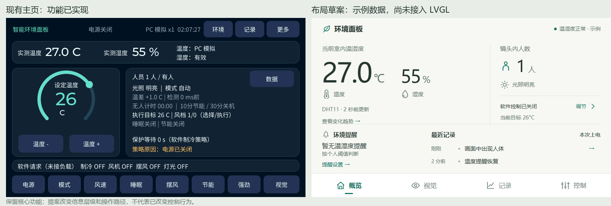
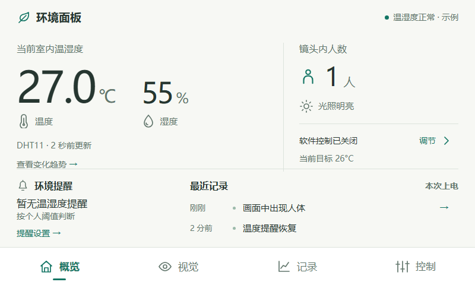
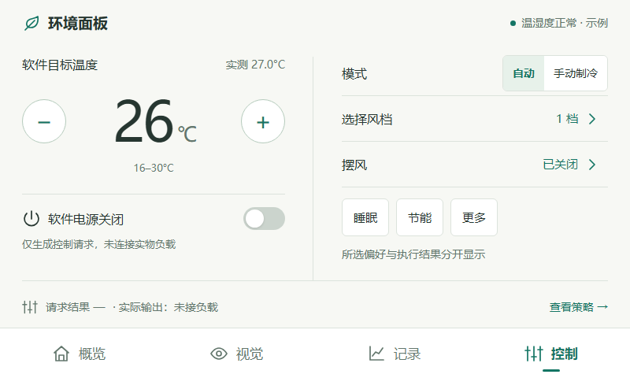
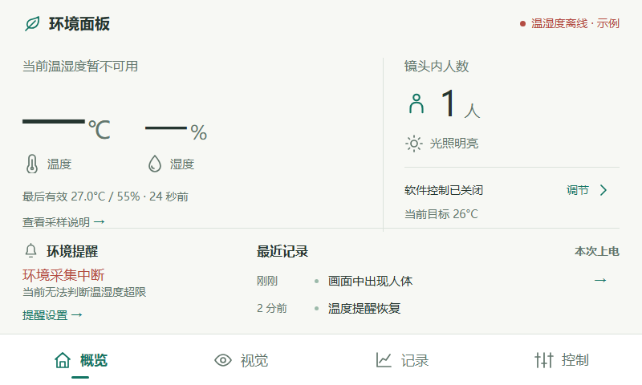

# V11 UI 设计参考与 800×480 交互草案

后续用户明确要求保留首页调温，并选择SmartHub风格、允许融合其他演示优点。最新选择稿与主方向见 [SmartHub融合方案](ui-options-20261013.md)；本文保留首次草案的参考与分析，不作为当前移植方向。

日期：2026-10-13。本文为下一版的设计提案，**尚未移植到 LVGL 或烧录**。本轮已完成的 V10 模型接入与摄像头预览精简见 [V10 说明](model-upgrade-20261013-v10.md)；其配套固件保留在 `build/firmware/model_20261013_v10_final2/`。

本次把工作分为现状梳理、公开设计参考、功能分层、交互草案和后续 LVGL 接入五部分。已有屏幕尺寸、源码与功能边界足以制作草案。这里先假设日常主要任务是查看环境与镜头内人员状态，调温属于另一个明确任务；若以后产品主任务变成频繁调温，可把加减控件移回概览，其他结构仍可复用。

## 现有界面的问题

当前主页同时展示环境数据、目标温度圆环、人员判断、执行参数、保护时间、策略原因、四路请求和七个操作按钮。实测温度27℃与目标26℃的层级相反：目标值占据最大视觉区域。环境、记录、数据、视觉、更多入口又分布在三个位置，用户需要记住各个入口在哪。

边框、圆角块和按钮使用近似的视觉强度，使“阅读状态”“设置偏好”“进入页面”不容易区分。大段诊断或策略文字占据主界面，还会把原本可用于阅读的空间压缩。V10 已按要求移除视觉页的稳框切换和模型常驻信息；主页的信息层级仍可以进一步调整。

下面左侧为现有 LVGL 的实际 PC 渲染，右侧为本次原创 HTML 草案。两侧均为示例数据，右侧不是已实现的固件界面。

## 从设计网站借鉴什么

以下是已读取的官方公开材料。右栏是结合本工程作出的设计判断，不是网站提供的 N647 成品方案。

| 参考 | 已读内容 | 本工程的适配方向 |
|---|---|---|
| [墨刀：智能家居 APP 原型](https://modao.cc/ad/blog/home-app-prototype-design.html) | 强调功能优先级、清楚的导航、一致的视觉；提供触控中控屏模板入口 | 以中控设备的任务为起点，区分状态与操作，避免把手机应用的登录、商城和房间管理直接搬来 |
| [墨刀：HMI 工业中控案例](https://modao.cc/ad/blog/hmi-industrial-control-prototype-templates.html) | 将实时状态、手动操作、参数设置与报警查询分开，强调反馈与减少菜单层级 | 概览、控制、记录分工；正常、未知、故障都有对应的文案和操作 |
| [即时设计：家居 APP 模板介绍](https://js.design/special/article/home-design-app.html) | 公开介绍组件规范、深色界面及独立的温度设置弹层等结构 | 温度调整和详细偏好拥有专门的操作区；借鉴层级，不照搬大量卡片 |
| [即时设计：自动布局](https://js.design/special/article/automatic-layout-design-interface.html) | 介绍方向、间距、内边距及尺寸适应等布局规则 | 按统一网格对齐数据、状态、操作；移植时用 LVGL 布局与共享样式表达 |
| [iconfont：官方使用帮助](https://www.iconfont.cn/help/detail?helptype=code) | 提供 PNG、SVG 等形式，并建议成体系的图标通过项目管理 | 使用同一图集、统一线宽和视觉大小，保留文字标签；转换为板端资源后使用 |

墨刀和即时设计的上述正文已读取。即时设计社区资源画布只返回需要 JavaScript 的页面；墨刀素材详情未取得有效正文。没有进入编辑器、查看完整模板画布或下载模板，不能据此推断是否必须登录。iconfont 官方帮助来自其公开搜索收录正文，直接抓取页面为空。

草案图标和示意画面均由本次代码绘制，未使用网站素材。后续选用 iconfont 时，应记录图集、作者、资源许可及所需图标，并只转换实际使用的子集。网页的 CSS、JavaScript 或 `symbol` 引用方式不能直接用于 LVGL。

## 提案：四个固定入口

采用“概览／视觉／记录／控制”，保持同层导航位置固定。通过字号、间距、对齐和少量分隔线表达层级，容器主要用于弹层或独立操作组。草案选择浅色背景、深色文字与单一绿色强调色；颜色可以替换为现有暗色主题，结构不需要改变。

| 页面 | 主要任务 | 现有功能的去向 |
|---|---|---|
| 概览 | 看当前环境、镜头内人数、提醒与最近事件 | 实测温湿度及有效性、人员确认结果、明暗、目标与软件电源摘要；进入控制和趋势的快捷入口 |
| 视觉 | 看检测与拍下当前画面 | 相机与人体框、FPS／AI Hz／触摸摘要、按需展开的诊断、现有手动留图 |
| 记录 | 看变化与发生过什么 | 页内切换事件与趋势；整合环境、软件请求、控制事件和采样点详情 |
| 控制 | 设置偏好并理解结果 | 电源、目标、自动／手动制冷、风档、睡眠、节能、摆风；强劲与灯光进入“更多”；执行结果和策略单独解释 |

温湿度提醒设置从概览进入。诊断仍从视觉页进入。所有现有控制能力保留路径，不以减少首页按钮为由删除功能。最近事件只展示摘要，避免全文占据首页。

### 可交互草案

打开 [HTML 草案](design/v11-ui-concept/index.html) 即可使用，文件完全独立，无网络资源依赖。可点击四项导航、目标温度加减、软件电源、模式、风档、睡眠、节能、摆风及更多偏好；趋势支持切换温湿度与拖动查看示例采样点，视觉支持展开／收起诊断。

顶部“正常示例／温湿度离线示例”用于检查缺失状态。截图页眉也标明“示例”，避免图片脱离正文后被当作实板结果。

草案只更新浏览器中的示例值，没有运行工程的纯 C 控制逻辑。请求结果显示为空，而不是用浏览器中的简化算法冒充板端结果。视觉使用原创矢量示意图，无摄像头连接；记录与曲线也都是示例。

## 设计必须保留的数据语义

- 实测与目标分开。温湿度失效时当前读数显示为空；最后有效读数附数据年龄。曲线在失效后的末端留空，不把旧值标成“现在”。
- 人数限定为“镜头内”，不能由一个视野推断整间房的人数。AI未知或确认中应显示对应状态，不能统一写成无人。暗光有人不代表识别到真实睡眠。
- AP3216C 当前是 ALS 原始值与明暗判断，没有 lux 换算。图表0–1000是展示范围，不是传感器物理量程。
- 模式只有自动和手动制冷。选择风档1–5不等于执行风档；选择档位会取消强劲。睡眠／节能等策略可进一步限制执行值。
- 所有负载仍未连接，必须注明“软件请求／未接负载”。请求时长与开启次数不是耗电量，不能显示节电百分比。
- 提醒确认不解除超限，稍后提醒默认静默5分钟；已有超限提醒遇到采样失效时不能被清成正常。个人阈值与空调控制策略分开。
- 事件回看目前为最近四条和附近显示帧，断电清空；128×128缩略图并非精确推理源帧。“温度提醒恢复”表示退出个人超限范围，不能改叫“DHT11恢复”。
- 趋势每5秒采样、最多60点，控制事件另有12条缓存。时间依据运行时长，不能伪装成日期时钟或长期历史。

这些约束来自当前 `app_climate_logic.c`、`app_environment_alert.c`、`app_ui_insights.c`、`app_ui_journal.c` 和 AP3216C 驱动的只读核对。

## 移植到现有 LVGL 的实现顺序

1. **建立页面与导航结构。** 先组合现有环境、视觉、历史和控制页面，统一返回行为。保留当前快照和动作接口，不在布局迁移中重写控制逻辑。
2. **调整主页层级。** 去掉无实际刻度作用的主圆环，用实测大读数、镜头内人数、提醒和最近事件组成平面布局。目标加减集中到控制页，首页保留快捷入口。
3. **建立共享组件。** 统一数据读数、状态标签、导航项、选择控件、开关、提示与弹层；正常、选中、按下、禁用和未知状态共用规则。使用 [LVGL 9.2 Flex](https://docs.lvgl.io/9.2/layouts/flex.html) 和 [Grid](https://docs.lvgl.io/9.2/layouts/grid.html) 表达分组和对齐。
4. **接入字体与图标子集。** 沿用现有中文字体生成流程，主数字建议48–72px，正文18px左右，辅助文字14–16px；图标24–28px。高频触摸区域48–56px，次要入口也扩大命中范围。字体资源可按实际字符与图标码点生成，参见 [LVGL 9.2 字体](https://docs.lvgl.io/9.2/overview/font.html)。这些尺寸是本设备的设计建议，需要上板验证。
5. **补齐所有状态。** 在PC覆盖AI未知、人员确认中、ALS未知、过期读数、已确认仍超限、静默提醒、已有提醒时传感器失效、记录为空和数据不足。本次草案只覆盖正常与温湿度离线，不能宣称其余状态已验证。
6. **验证视觉与触摸。** 摄像头页增加固定导航会减少可见高度；草案的358×358示意画面只是版面占位，不能直接替换当前480×480显示／256×256推理的共同裁剪与人体框映射。正式实现应提供最大画面方式，并独立核对显示投影、触摸坐标和框裁剪。

移植采用当前工程的 LVGL 9.2.2 API。网页原型只是设计依据，不直接搬 CSS，也不依赖在线编辑器的导出代码。保留现有显示端口、透明前景提交、线程归属、触摸恢复与 NPU 数据流。

## 本次验证与下一阶段验收

使用本机Chrome无头模式实际打开HTML，检查页面切换、调温、电源、风档、摆风、睡眠、离线读数、采样说明、温湿度曲线与离线末端、事件页以及诊断展开／收起，均通过。七种页面／场景截图均为800×480；已检查文字裁切与主要对齐，并修正事件恢复语义及选择风档取消强劲的行为。验证证据位于 `D:/Learning/AC-N647/tmp/ui_reference_20261013/`。

后续真正移植的验收重点：用户能在概览迅速区分“实测／目标／数据未知”，主要功能最多两次操作可达；极端数值和完整错误文案不裁切；边缘按钮准确响应；诊断滑动、相机画面、检测框、DHT11有效性与所有控制动作继续通过PC和实板回归。还需检查LVGL堆峰值、图标／字体体积、页面更新耗时及触摸恢复，不能由网页截图宣称MCU更快。

本次仅新增设计文档、HTML及图片，未修改板端C源码、重编译V10或连接烧录工具。下一版建议优先实现导航与主页层级，再扩展记录和控制页面。
