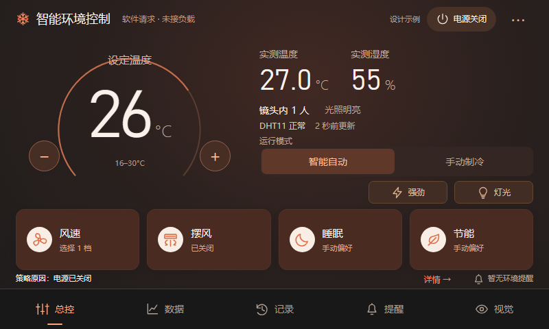
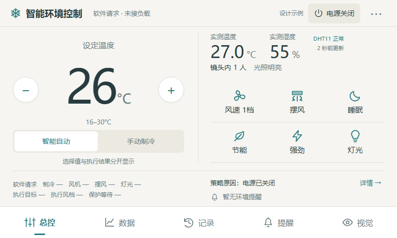
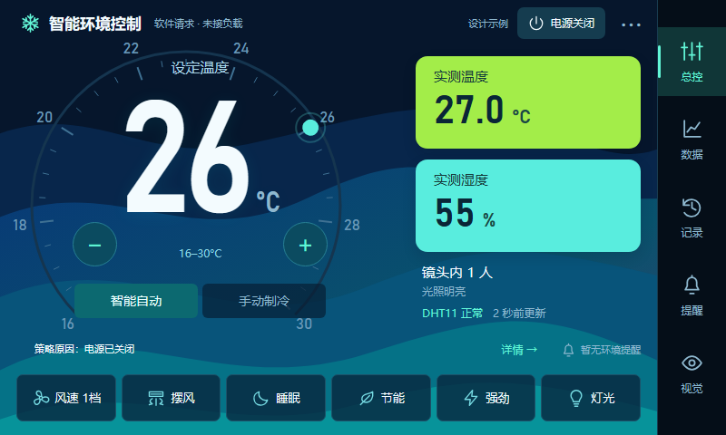
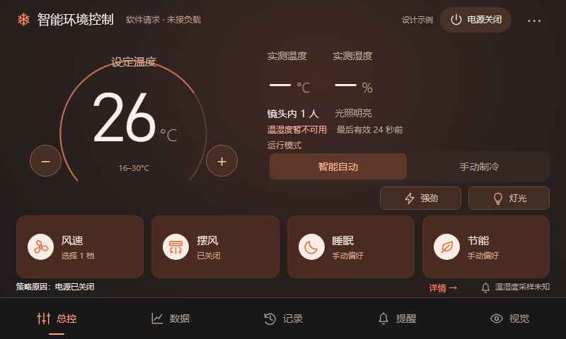

# 全功能 UI 选择稿与 SmartHub 融合主方案

最新方向：用户认可D的蓝色风格，并要求Smartwatch式紧凑表盘、保留设定温度主读数。预览默认已切到F，见 [最新表盘修改稿与关键节点](ui-watch-refinement-20261013.md)。下面的E主方案记录保留为前一轮参考。

2026-10-13。用户要求保留现有全部功能，希望有吸引力、舒服的界面；随后明确选择官方 SmartHub 的家居面板风格，并允许融合其他演示的优点。

本文记录前一轮 **800×480 可交互设计稿**。F 的原生 LVGL 实现及最终编译已随后完成，实际效果与验收见 [紧凑表盘接入记录](ui-watch-refinement-20261013.md)。E 等方案仍保留用于比较。

## 查看设计

打开 [交互预览](design/ui-options-20261013/index.html)，当前默认显示 **F：紧凑Smartwatch温控**。顶部可切换其他方案、开关动效及注入温湿度失效示例。上一份 `v11-ui-concept/` 是先前环境面板草案，本稿已把调温与电源放回首页。

| 方案 | 视觉与布局 | 适合的取向 |
|---|---|---|
| E：SmartHub 融合主稿 | 暖色深底、白色图标徽章、温控大数字和细线弧、四个主要控制组件、短促操作动效 | 当前主方向，保持空调总控属性与家居产品的整体质感 |
| A：深色圆环总控 | 原有深色体系、温控圆环、六个快捷控制和底部导航 | 接近现有界面的操作习惯 |
| B：浅色数字总控 | 平面大数字、轻分隔、图标快捷操作、底部导航 | 阅读与操作优先，减少独立卡片背景 |
| C：侧栏监测工作台 | 固定侧栏、实测数据和小趋势图、独立温控区、底部快捷控制 | 经常查看趋势与状态 |
| D：动态彩色仪表 | eBike 风格的大数字、温度刻度、彩色背景、亮色实测区与右侧导航 | 仪表展示感与较强的视觉冲击 |

E主要借鉴SmartHub的完整画面配色、统一组件和状态图标；借鉴Thermostat的目标值与调温环；借鉴eBike的大数字和数值变化反馈。没有搬入门锁、充电、音乐、网络设备、室外天气或日期时钟等本工程未接入的功能。

## 吸引人的官方界面怎样实现

[LVGL 官方演示页](https://lvgl.io/demos)说明，其在线交互演示由真实LVGL应用编译成浏览器版本。本文的HTML是独立设计原型，作用是比较布局与点击路径；它不运行工程的LVGL或控制逻辑。

已实际阅读官方源码：

- [SmartHub 公共样式、尺寸和资产](https://github.com/lvgl/lv_demos/blob/master/src/high_res/lv_demo_high_res_util.c)：为800×480等分辨率准备尺寸体系、数字字体、图标和轻／深两套资源，共享主题颜色及文字样式。完整背景与主题图片提供画面质感。
- [Smart Home 控件](https://github.com/lvgl/lv_demos/blob/master/src/high_res/lv_demo_high_res_app_smart_home.c)：利用容器、图像、开关、滑块及subject绑定，将状态、交互和样式组织为统一组件。
- [eBike 主界面](https://github.com/lvgl/lv_demos/blob/master/src/ebike/lv_demo_ebike.c)与[数字／仪表实现](https://github.com/lvgl/lv_demos/blob/master/src/ebike/lv_demo_ebike_home.c)：采用背景与刻度图片、自定义大数字字体、roller、arc及lv_anim。部分页面图标使用Lottie，主数字与仪表不依赖Lottie。

实际制作可以分成四层：

1. **视觉规范**：先确定布局、字体、间距、色彩、圆角和图标规则；每个容器服务于一个任务。
2. **图形与资产**：图标、背景、刻度和文字资源按实际尺寸准备，转换为LVGL能使用的字体子集或图像数据。
3. **交互组件**：控件明确区分默认、按下、选中、禁用、未知与异常状态。
4. **状态与动画**：真实快照更新数值与状态，按钮继续产生原有操作；动画只负责视觉反馈，不计算或伪造控制结果。

E原型的页面进入约230ms、调温数字反馈约240ms、弧线过渡约320ms，可通过“动效开／关”比较。没有连续改变温度示例值以冒充采样，也没有用风机旋转动画表示实物负载正在运行。图标和示意图均为本稿代码绘制，官方资产未复制到工程。

## 全部功能的保留范围

“保留全部功能”是移植要求。原型演示主要选择与页面入口，正式实现仍接现有快照、事件回调和数据模块；不能把原型检查当作板端全功能验收。

| 原功能 | E中的位置 | 移植时保留的细节 |
|---|---|---|
| 调温、电源、模式 | 首页数字／加减、顶部电源、模式选择 | 16–30℃、1℃步进、自动／手动制冷，动作与原策略一致；后续F关键节点用户明确选择仅加减，原圆环拖动按该选择取消 |
| 风档、左右／上下摆风 | 首页风速、摆风组件 | 档位1–5、分别选择两个方向；风档选择取消强劲 |
| 睡眠、节能、强劲、灯光 | 首页四个主要组件与两个小入口；更多中也可设置 | 人工偏好与自动策略分开；所选值与执行值分开 |
| 软件请求与策略原因 | 首页摘要、“详情”及数据页 | 四路请求、执行目标、执行风档、保护等待、无人持续时间、策略原因；未接负载说明 |
| 环境曲线 | 数据→环境 | 温度、湿度、ALS原始值、镜头内人数；温度同时显示执行目标；放大、拖动、取点、采样质量、真实运行时刻与选择保持 |
| 请求曲线与统计 | 数据→软件请求 | R1–R4、放大取点、请求时长／次数／未知时长；不转换成耗电量 |
| 控制事件 | 数据→控制事件 | 保留原有12条缓存及原因变化 |
| 温湿度提醒 | 提醒页 | 温限±1℃、湿限±5%、共用持续时间±30秒、确认全部、稍后全部；各通道状态与静默计时 |
| 图片事件与回看 | 记录页 | 最近4条、128×128附近显示帧、来源／运行时刻／人数／温湿度与有效性、图片状态、记录被替换提示 |
| 手动留图 | 视觉→留图；正式记录页继续保留“拍一张”入口 | 复用已有事件快照，断电清空；不是录像 |
| 相机与人体框 | 视觉，全800×480画面方式 | 原显示／推理共同裁剪与人体框投影；不在视觉页常驻模型名或稳框切换 |
| 诊断与恢复 | 视觉→诊断，可收起／滚动 | 原有FPS、AI Hz、触摸、传感器、初始化错误、总线和恢复信息；模型详情只在诊断中 |
| PC演示与实板输入 | PC数据演示入口；原按键与红外保持 | 开始、暂停／继续、停止并恢复；实板不提供暂停AI或相机操作 |

原型的请求曲线使用示例开关序列；请求统计与执行结果没有绑定板端数据，保留空值。提醒原型只简化演示温度超限与确认／静默，正式移植不能丢失湿度独立状态、采样失效时保留提醒、恢复迟滞与持续时间。

## 在当前工程落地

当前是LVGL9.2.2，已有arc、roller、image、canvas、动画、Flex／Grid与observer，可据此实现上述组件与局部动效。官方最新SmartHub源码部分API和配置与本版本不同，文件系统、PNG解码与大型字体配置也不能直接照搬；先适配现有主题、静态资产与动作接口，再做动画。

当前Lottie／ThorVG／VECTOR_GRAPHIC未启用。本设计的主要效果可以先用原生动画与小型资产实现；Lottie后续按需要评估，不作为本次视觉设计的前提。[LVGL9.2 Lottie依赖和缓冲要求](https://docs.lvgl.io/9.2/widgets/lottie.html)

资源预算需要单独核对：当前V10应用末地址至模型分区只有211424字节间隔，未经压缩的800×480 RGB565背景为768000字节，不能直接加到应用里跨过模型分区。真正实现时应选择代码绘制、紧凑图标／字体子集或另行规划资源位置，并检查绘图缓冲、堆与刷新耗时。浏览器动效不代表板上能达到同样帧率。

## 本次检查

本机Chrome实际打开原型，检查五套布局的首页调温、电源、模式、风档取消强劲、双向摆风、数据与详情、四条记录、提醒设置／确认／静默、完整视觉／诊断、留图返回、失效读数，检查通过。导出800×480截图并核对文字与布局；截图暂停动画以得到清晰终态，交互预览保留动画和开关。

检查证据：`D:/Learning/AC-N647/tmp/ui_reference_20261013/options/`。这些结果只验证浏览器设计稿。原有LVGL、触摸、相机、DHT11与模型的板端行为本轮未修改，也未重新编译或烧录。
