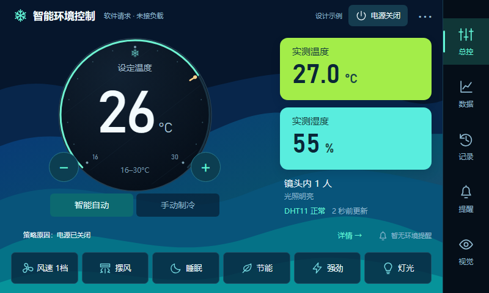
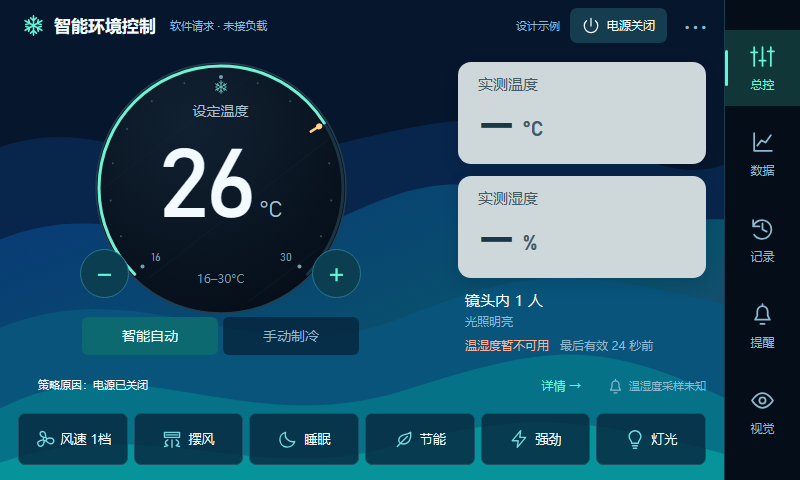
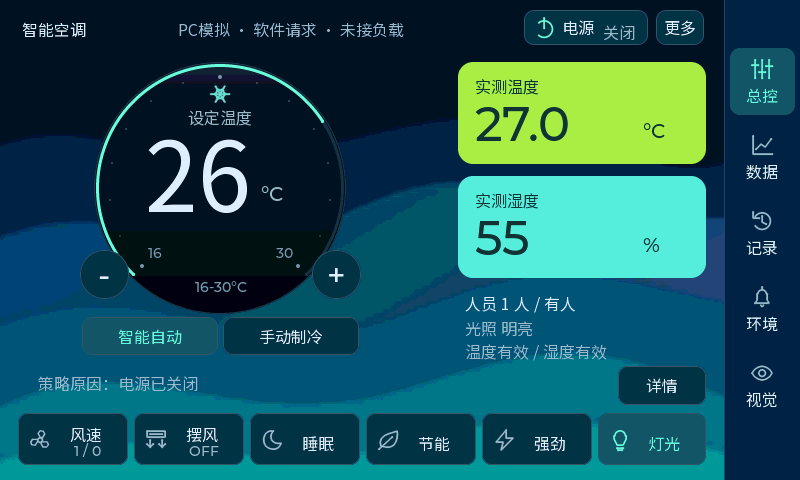
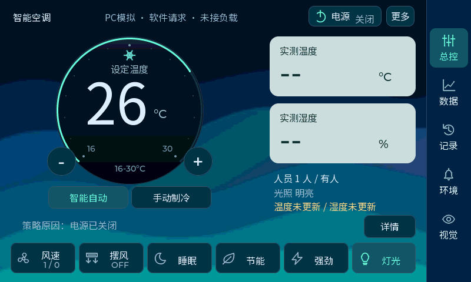
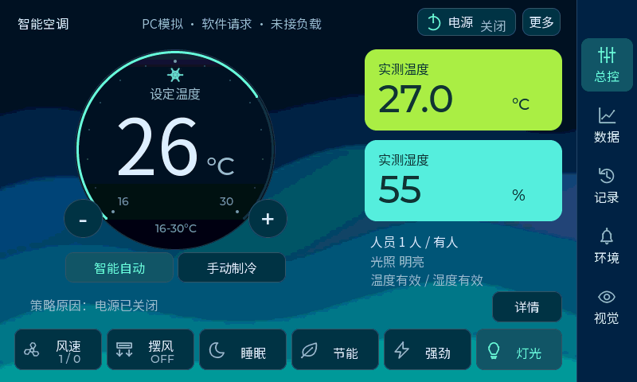

# F：蓝色面板与紧凑 Smartwatch 温控表盘

2026-10-13。F 方案已接入工程共用的原生 LVGL 页面，PC 交互回归和板端完整编译通过；最新表盘微调版已烧录并完整回读校验，用户切回Flash启动后已确认主页、触摸与摄像头正常。设计稿仍可用于比较方案；以下真实 LVGL 截图与设计稿分别标注。

## 已确认的方向

用户认可截图中的D动态彩色仪表风格，觉得左侧表盘臃肿，并要求在关键节点询问细节。第一节点已询问表盘形式及温度显示主次，用户回复：

- 表盘希望借鉴之前GIF中的Smartwatch风格，先做设计。
- 设定温度继续突出；实测温湿度放在右侧。

因此本稿保留D的深蓝波纹、亮色实测区域、右侧导航和底部操作，将左侧改为小型腕表式温控。Smartwatch参考中的时钟、秒针、电量、步数和日期不属于本工程功能，本稿没有加入这些数据。

## 修改稿

打开 [交互预览](design/ui-options-20261013/index.html)，现在默认显示 **F：紧凑Smartwatch温控**；顶部仍可切到D对比原稿。

| 项目 | 原D | 新F |
|---|---|---|
| 表盘绘制区域 | SVG451×348，超出温控容器 | SVG252×252，完整腕表式圆面 |
| 主数字字号 | 173px | 96px，仍为主读数 |
| 外围刻度 | 多条刻度、多个温度标签与光点 | 小点刻度，只标16／30；短指示针表示所选温度 |
| 指示 | 大范围刻度与光点 | 3px细弧、短指针、中心明确写设定温度 |
| 调温 | 首页加减 | 继续保留49×49加减按钮 |
| 模式与其他入口 | 原有位置 | 保留，不挤入表盘 |

短指针和细弧映射16–30℃设定值，没有钟点或电量含义。表盘背景采用原创渐变与少量纹理线，图标与形状均为代码绘制。所有装饰图层不拦截点击。用户在知晓原版已有圆环拖动后，明确选择“继续用加减按钮调温”，本次按该选择简化为仅加减；仍沿用`APP_ACTION_TEMP_UP/DOWN`，不改变温控业务规则。

数字反馈约220ms，指示弧／短指针过渡约280ms；用户选择克制反馈，F蓝色背景已静态显示。可使用顶部动效开关比较局部反馈。右侧实测区域继续显示数据有效性，温湿度失效时显示为空并转为中性色。

## 功能与验证

各方案共用原型动作和页面。首页调温、电源、自动／手动制冷、风档、双向摆风、睡眠、节能、强劲、灯光，以及数据、记录、提醒、视觉、诊断入口均保留。完整移植范围见 [UI功能对应表](ui-options-20261013.md)。原型使用示例数据，不运行工程的控制策略或硬件。

浏览器检查加入F后，六套布局共84个导航／选择／失效状态检查通过。已导出F主页、失效、摆风弹层和数据页800×480截图，核对数字、单位、范围标签、加减按钮、模式、策略行和底部操作的间距。截图导出暂停动画以显示清晰终态，交互预览保留动画。

检查证据仍位于 `D:/Learning/AC-N647/tmp/ui_reference_20261013/options/`。这些是浏览器设计稿结果，不代表实板帧率、触摸或LVGL资源验收。

## 关键节点

1. **方向与读数主次：已答复。** 蓝色D为外围风格，Smartwatch为表盘参考，设定温度主显示。
2. **结构与尺寸：已确认。** 用户选择“保留当前紧凑结构”，252px圆面、96px数字及当前主要布局作为后续基线。
3. **交互与动效：已确认。** 用户选择仅用加减按钮调温，以及数字／细环／页面短过渡、静态背景。原圆环拖动这一项交互按最新答复取消。
4. **LVGL实现：已完成电脑验证与板端编译。** 412 项 PC 交互与回归检查通过，545 个板端源文件重新编译、链接通过；用户随后选择优先微调数字与 °C 的大小、位置和对齐，最新效果见文末；之后再安排实板操作。

烧录已完成且完整回读校验通过；用户已确认主页、触摸与摄像头正常；AI帧率、人体框跟随和长期运行另待观测。

## LVGL 接入核对

- 公共入口继续使用`app_ui_init`、`app_ui_set_snapshot`、`app_ui_process`，显示端和业务层仍通过`app_ui_snapshot_t`及`app_ui_action_cb_t`交互。
- 首页重排优先局限于`app_ui.c`的创建与更新；控件继续调用原`APP_ACTION_*`，风档／摆风／偏好仍复用`app_ui_controls`，提醒、趋势和回看复用对应模块。
- 原温控环已经将`LV_EVENT_VALUE_CHANGED`转换为逐度的`APP_ACTION_TEMP_UP/DOWN`，并用`s_arc_sync`隔离快照回写。显示动画如果逐帧写弧值，必须同样隔离事件，避免把视觉插值反向变成调温请求。
- 当前普通界面快照更新周期200ms，LVGL定时处理在既有显示所有者调用；动画应在同一所有者内运行，不新增线程操作LVGL对象。
- 保持原800×480相机页、图像／人体框裁剪、显示提交和触摸恢复；新增首页背景不能改变相机后景层与透明前景的交接规则。
- 原中文字体为16px子集；原生96px数字需要独立准备少量数字字形。浏览器所用系统字体不能当作已接入MCU的字体资源。
- 背景已明确静态显示。资源、应用／模型分区和 PC LVGL 堆已核对，摄像头帧缓冲与显示提交保持原有实现。

以上接口约束已用于原生实现；实板性能与触摸体验仍待烧录验证。

## 原生 LVGL 实现与效果

这张图由 Windows SDL 预览运行真实 `app_ui.c` 与 `app_ui_watch_home.c` 后导出。设定温度为 26℃，右侧27℃／55%及人数为可控模拟输入，不是开发板的实时数据。数字和背景经过既有 ARGB8888 → ARGB4444 前景转换，因此这里比 HTML 草案更接近板端实际颜色与字体。

- 首页保留252×252表盘、96px数字、49px加减按钮；圆环仅作显示，不注册调温回调。用户选择只有加减调温，原圆环拖动按该选择取消。
- 顶部保留电源与更多，自动／手动制冷为明确的选择按钮；点击已选模式不再误切到另一模式。
- 六个底部入口为风速、摆风、睡眠、节能、强劲、灯光；风速和摆风复用原选择弹层。选中态来自共享快照，表示偏好而不是物理负载输出。
- 右侧总控、数据、记录、环境、视觉继续调用原模块。所有趋势、放大取点、提醒与事件图像、人体框和诊断均保留。
- 首页只保留策略摘要。详情可滚动查看执行目标与风档、手动／自动来源、保护等待、无人计时、采样年龄和四路软件请求；PC演示入口也在这里。实板不开放自动脚本回放。
- 数字反馈180ms、细环240ms；返回主页的两块实测区域做6px／140ms局部进入反馈。背景静态，没有整屏透明度动画或额外LVGL线程。
- DHT11失效后按原规则显示最后有效样本或未知，保留失败错误码和年龄；失效卡片转中性色，不伪造健康读数。

字体、背景与14个图标放在只读资源模块；背景200×120 RGB565放大至800×480。像素／位图共75,437字节，不在堆内新建整屏canvas。中文字体重新生成391个字符，并核对字符覆盖。资源与许可证见 [字体和背景说明](fonts/watch-resources.md)。详情格式缓冲使用静态存储，避免占满4096字节显示线程栈。

## 验证与固件

| 项目 | 结果 |
|---|---|
| Windows 共用 LVGL 预览 | 构建与正常退出通过 |
| PC 真实 SDL 点击、拖动、按键及故障回归 | 412项通过，0项失败 |
| 重点行为 | 加减一次1℃、拖环不调温、动画不产生动作、已选模式无动作、弹层阻止击穿 |
| 原有回归 | 温湿度独立有效性、DHT最后有效读数、双向摆风、风档、趋势取点、提醒、记录、透明摄像头叠层、10／30分钟策略 |
| PC LVGL 堆 | 峰值116,728B；完整回归结束空闲44,768B，最大连续空闲44,648B；完整性通过 |
| 板端完整编译 | 545个源文件全部重新编译，链接通过，无未定义符号 |
| 应用 BIN | 916,032B，`0x70100400` ～ `0x701DFE3F` |
| 模型分区前间隔 | 131,520B，未越过`0x70200000`模型起点 |
| 模型权重 | 沿用V10 YOLOv8n人体INT8 256配套权重，逐字节SHA核对；本轮未改变模型 |
| 其他检查 | 8项显示／线程／启动契约、模型绑定与权重、两套资源生成一致性均通过 |
| 烧录／实板验收 | 最新微调版已烧录并完整回读校验；用户确认主页、触摸、摄像头正常，实际AI帧率未记录 |

最终目录为 `build/firmware/ui_watch_20261013_f_final/`，包括 `appli.hex/bin/elf/map`、同版本 `network-data.hex/bin`、构建指纹 `manifest.json` 和 `release-ui.json`。首次构建期间因范围标签修正被指纹检查拒绝的 `ui_watch_20261013_f/` 不作为交付；最终目录全部重新编译且指纹一致。

仍运行V9.3的开发板需要更新与此应用匹配的V10模型权重，不能把新应用与旧YOLOv2权重混用；FSBL继续沿用已验证版本。移植初版阶段未操作ST-LINK；最新微调版现已完成实际烧录，见文末记录。

PC证据在 `D:/Learning/AC-N647/tmp/ui_native_20261013_f/pc-final/`，其他核对及交付摘要见同目录父级 `verification.json`。打开 [VS Code预览工作区](../simulator/lvgl-preview.code-workspace) 后按F5即可实际操作新版。

## 表盘读数微调（最新）

用户在原生视觉节点选择“先微调表盘细节”，并进一步选定“数字与 °C 的大小、位置和对齐”。因此本次保持252px圆面、96px主字号和加减操作，局部调整读数组。

- 单位由已启用的Montserrat20改为已启用的Montserrat32；主数字继续使用96px数字子集，不新增字体资源。实际字形高度约74px／24px，主次仍明确。
- 原数字逻辑基线为212，单位为201，相差11px；现在按各字体的`line_height - base_line`计算局部位置，统一到基线220。
- 用实际文字推进宽度计算“数字＋8px间距＋单位”的总宽度，以表盘圆心x220居中，消除独立文字框带来的偏移。16～30均为固定宽度的两位数字，避免调温时水平跳动。
- 整组读数下移8px，使数字实际像素中心更接近表盘圆心；数字与单位放在同一透明容器中，共同完成180ms的轻微位移。无效目标的`--`使用原48px字体，继续按字体度量对齐单位。

[实际截图前后对比](design/dial-alignment-20261013/index.html)可切换旧版与微调版。此页展示原生截图，实际操作仍使用共用的Windows LVGL预览窗口；温湿度仍为PC模拟数据。

本轮PC完整回归仍为412项通过、0项失败，已验证调温动画完成后读数组恢复原位且不产生额外动作。LVGL堆峰值115,888B，结束空闲44,456B，最大连续空闲44,336B，完整性通过。字体／图形生成一致性、正式UI字段和透明像素转换检查通过。

板端545个源文件全部重新编译、链接通过，无未定义符号；应用916,352B，末地址`0x701dff7f`，距离模型起点剩131,200B。最新配套应用与V10模型目录为 `build/firmware/ui_watch_20261013_alignment_final/`，指纹、HEX／BIN一致性和权重SHA均通过。初版F固件保留在原目录；最新微调版现已烧录并完整回读校验，见下节。

## V11 实际烧录（2026-10-13）

用户明确要求先烧录观察上屏效果，最新 `ui_watch_20261013_alignment_final` 应用与配套模型已烧入STM32N647 Rev B。应用916,352B、模型3,011,681B，两次下载校验和所有有效字节独立回读逐字节比对均通过。写前备份了应用917,504B与模型3,014,656B完整覆盖扇区；旧应用确认仍为已验收V9.3，FSBL32KiB与旧已验证内容一致，前后无变化。没有整片擦除。

烧录日志、覆盖扇区备份和结果在 `D:/Learning/AC-N647/tmp/ui_watch_flash_20261013_v11_alignment/`。用户切回Flash启动并上电后反馈“已上电，主页、触摸与摄像头正常”。本次实板确认范围为主页、触摸与摄像头显示；人体框跟随、AI更新率、后处理状态及模型准确率未另行确认。

实板反馈已写入烧录目录的 `flash-result.json/runtimeEvidence`。后续修改以此UI与摄像头显示正常版本为基线，不把这次反馈扩展为模型准确率或长期稳定性证据。
