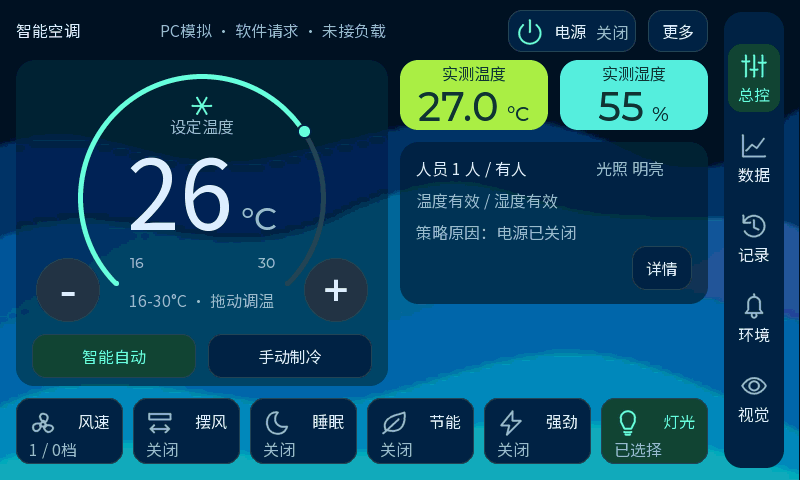
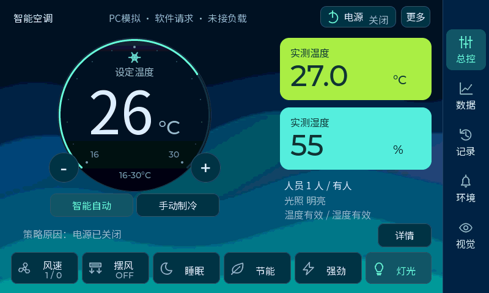

# LVGL 电脑界面预览

在 Windows 上打开与开发板共用的 LVGL 界面，用鼠标操作按钮，并用键盘调整示例数据。初始环境温度为 **27°C**，湿度为 **55%**。这些是电脑模拟数据，不是开发板的实时读数。

初始人数为 1，光照为 250，逻辑电源关闭，目标温度为 26°C。窗口客户区为 800×480，标题标有“模拟数据”。

## 快速启动

1. 双击本目录的 `lvgl-preview.code-workspace`，使用 VS Code 打开专用工作区。
2. 按 **F5**，选择“PC 界面预览”。预览会先配置、构建，再打开可交互窗口。
3. 也可以通过“终端 → 运行任务”选择“预览：运行”。“预览：配置”和“预览：构建”可单独执行。
4. 鼠标点击界面上的按钮；当前Bento主页用 **−／＋** 或拖动圆环调温；圆环轻点不会跳温，移动后按1℃步进；**风速** 直接选风档，**摆风** 分别设左右／上下摆风，右上 **更多** 可设置灯光等偏好，弹层 **完成** 返回。用户页 **数据** 打开趋势与事件，顶部 **控制请求／环境趋势** 切换内容，点击任意图表放大并拖动读数，**返回曲线** 退出大图。**视觉** 进入摄像头预览，默认稳定绘制；**诊断** 展开或收起诊断，**返回主页** 返回。关闭窗口即可退出。

工作区只打开上一级工程目录。CMake 的源目录设置仅作用于这个工作区，使用 `simulator`，不修改其他 VS Code 配置。

## V12 Bento 并排小卡大读数（当前源码与PC预览）

当前源码按用户最新反馈将亮绿温度与青色湿度改为一行两张148×70px小卡，数字从并排初稿32放大至40，单位20并按基线对齐。环境状态上移，增强蓝色波浪露出更多。主温控和底部六个操作继续保留，名称与状态同Noto16两行，图标为28px原尺寸。64px加减及拖环可改变16～30℃设定值，轻点／轻微抖动／程序动画不调温。原有业务、数据、记录、提醒、诊断和PC演示保留。



[原大卡／并排32／最新40实际对比](../docs/design/bento-compact-20261014/index.html) · [实现与验证](../docs/ui-bento-compact-20261014.md)

438项PC回归和546源文件板端完整编译通过，并排小卡版已于2026-10-15烧录并完整回读校验，用户已确认Flash启动后新界面、调温、触摸和摄像头正常；以下V11／V10／V9.x说明作为历史记录。重新运行F5会打开当前并排小卡大读数界面。

## V11 F 紧凑主页（前版）

蓝色静态背景、252px表盘与96px目标数字，右侧为大号实测温湿度。底部直接访问风速、摆风、睡眠、节能、强劲和灯光；右侧保留数据、记录、环境和视觉。顶部电源、自动／手动模式及右上更多均可操作，**详情**打开可滚动的执行状态与四路请求，**PC演示**由详情进入。点击当前模式不切换，数字与细环动画不会发送调温动作。

温湿度失效显示未知或DHT最后有效读数及错误／年龄，卡片变为中性色。完整PC回归412项通过；板端545源文件重新编译通过，最新表盘微调版已烧录并完整回读校验，用户已确认主页、触摸与摄像头正常。此前V9.x／V10章节为历史说明；当前仅取消经用户确认的圆环拖动手势，业务策略及其他功能保留。

当前表盘已微调：数字和单位统一基线，°C使用32字号，读数组居中并共同完成短反馈；其他结构不变。



[实际效果、资源、固件和验证证据](../docs/ui-watch-refinement-20261013.md)

## 模拟输入

先点击预览窗口，让窗口获得键盘焦点。

| 按键 | 效果 |
| --- | --- |
| `0` / `1` / `2` | 模拟无人 / 1 人 / 2 人 |
| `J` / `K` | 将模拟单个人体移到画面左侧 / 右侧，观察人体框 |
| `G` | 开启／关闭模拟输入抖动，观察默认稳定绘制；与真实摄像头无关 |
| `V` / `X` | 开始或暂停场景 / 停止场景并恢复原模拟环境与偏好 |
| `D` / `B` | 模拟暗环境 / 明亮环境，ALS 分别为 50 / 250 |
| `T` / `Shift+T` | 环境温度增加 / 减少 1°C |
| `H` / `Shift+H` | 环境湿度增加 / 减少 1% |
| `C` | 注入／恢复 AI 离线，人数显示未知，取消连续无人判断 |
| `A` | 注入／恢复光照离线，停止暗光自动睡眠 |
| `S` | 注入／恢复温湿度离线，制冷请求停止 |
| `F` | 切换 1×／60× 仿真时间；30 分钟策略可在约 30 秒内演示 |
| `R` | 重置模拟数据、偏好和故障；取消进行中的鼠标手势 |
| `P` | 模拟 WK_UP，切换电源 |
| `M` | 模拟 KEY0，切换模式 |
| `↓` / `↑` | 模拟 KEY1 / KEY2，降低 / 提高目标温度 |

这些输入通过共享的气候控制逻辑驱动界面；触摸按钮使用鼠标点击。`D` / `B` 调整光照，不切换页面。

## V9.5 环境提醒与事件回看

主页右上 **环境** 打开个人温湿度提醒设置。默认温度≥30°C／湿度≥70%连续120秒才提醒，可调整高限和持续时长；**确认提醒** 标记已看过，**稍后提醒** 静默5分钟。`T/H` 改变模拟读数，`F` 可快进，`S` 注入温湿度失效：失效清除尚未完成的持续确认，已经触发的提醒保留为采样不可用。温湿度分别判断有效性，不改变原来的气候控制请求；设置只保存本次运行，`R` 恢复默认值。

**记录** 打开最近四条事件及128×128图片；**拍一张** 手动保存读数和当前模拟画面。`0/1` 切换人数，等待原有确认后记录有人／无人变化。环境持续超限与恢复也自动记录。第五条覆盖最早记录，当前选择被淘汰时提示重新选择。记录与图片仅在RAM中，不写Flash；PC／实板／演示来源切换时分开会话，图片是事件附近显示帧，不是精确NPU输入帧或身份记录。

PC视觉背景改为中央480×480测试图与简单模拟人物，两侧黑边，与板端新的模型检测范围一致。图片明确标注PC模拟，FPS／AI Hz仍显示缺失符号，不能据此判断硬件性能。新显示支路的摄像头启动、帧率及实板图片需要烧录后验证。

效果与编译证据见 [V9.5记录](../docs/lifecycle-20261012-v9-5.md)。共享LVGL配额为160 KiB，图片另用128 KiB固定缓冲；最终完整自检383项断言通过，结束时LVGL空闲64,216字节，堆完整性正常。

## V10 模型与精简预览

板端源码已接入YOLOv8n人体INT8、256×256；PC窗口仍使用模拟检测结果，不执行该神经网络。预览移除“框：稳定／原始”按钮与模型型号／尺寸常驻文字，默认保持稳定框。模型信息只在**诊断**内显示；模型权重／接口不匹配时说明具体问题。完整自检389项断言通过，新增故障状态仅为PC注入测试。

最新配套固件在 `build/firmware/model_20261013_v10_final2/`，应用和新模型权重须一起更新。当前尚未烧录，不能用PC窗口证明模型准确率或实板性能。[模型接入、操作与证据](../docs/model-upgrade-20261013-v10.md)

## V9.4 统一主题与控制交互

首页保留控制按钮、圆环调温和软件风档进度，显示实际温度减执行目标的温差，以及人员检测的数据年龄；输入失效或过期显示未知。DEBUG保留人体框和诊断，固定分区线、分区说明与送风建议已移出运行界面。

DATA共用生产历史模块：5秒采样、最多60点，正常连续采样时约5分钟；漏采不补点，实际跨度可能更长。保存12条控制事件，页面显示最近8条。温湿度、原始光照和人数使用有效位，没有有效数据时显示曲线空缺；黄色温度线表示执行目标。光照原始值不是lux，图表范围0～1000；范围外数据仍保存在历史中。软件制冷请求时长和启动次数不是实测能耗。

点击顶部“控制请求”切换为R1制冷、R2风机、R3摆风、R4灯光四张柱状图，0表示请求关闭，1表示请求开启，缺失数据留空；“环境趋势”切回原曲线。切换只改变展示，复用原来的图表与采样，不改变电源、偏好、请求或历史会话。底部时长与“观测开启”次数仅统计R1；首次看到已开启以及缺失数据后的开启不虚增次数。它们是软件请求，尚未驱动物理负载。

点击图表进入大图，复用同一组图表对象与外部数组；显示窗口范围、实际首末采样时间和选中点值。温度范围包含黄色执行目标线，请求范围保持0～1。拖动后按时间戳和会话固定选择，新点到来不移动该选择；原点被淘汰或来源会话变化时明确提示并跟随最新。缺失值显示未知，横轴按采样顺序排列。返回后恢复四图、60个槽和事件侧栏。

DEBUG默认稳定框，轻量匹配与按采集时间的平滑只改变显示坐标，不改变人数、置信度和空调输入，也不识别人身份；无效、空框或人员数据失效即清除显示。PC的模拟框约每33ms更新，G加入±8px横向抖动以便观察；60×只加速模拟时钟，不代表摄像头60倍帧率。实板效果需按实际人体移动观察。

睡眠／节能按钮选中状态表示手动选择，主页另列自动睡眠／节能来源。显示“选择／执行”两种风档；睡眠、节能对强劲的限制遵循原策略。风速、摆风和更多设置共用持久弹层，点击遮罩不会触发下层按钮，开关弹层不发送控制动作。

DEMO按56秒墙钟脚本展示入场、升温、夜间、无人10/30分钟策略、AI故障及恢复。部分阶段加速模拟时钟，实际规则仍逐步执行；暂停冻结脚本和模型时钟。停止、播完或手动输入会恢复此前的模拟环境与控制偏好，并重新开始相关保护/确认计时。完整重置仍用R，P仍模拟WK_UP。模拟手动输入和脚本回放使用不同历史会话，切换时清空当前历史以免混合来源。

实板DATA使用当前真实采样；未接温湿度传感器时不产生模拟温度。实板DEMO是场景引导，自动回放按钮禁用。PC摄像头背景与人体框是模拟图像和几何，不是开发板视频；该版本没有训练或部署强化学习控制器。

## 构建与运行

使用本机现有工具，不需要 Node、浏览器或新增插件：

- C 编译器：`C:/msys64/mingw64/bin/gcc.exe`。
- CMake：`D:/Visual Studio/Common7/IDE/CommonExtensions/Microsoft/CMake/CMake/bin/cmake.exe`。
- Ninja：preset 使用 `C:/msys64/mingw64/bin/ninja.exe`，与 GCC、SDL2 使用同一个 MSYS2 安装目录。
- 配置与构建 preset 均为 `lvgl-preview`。
- 输出：`simulator/build/lvgl_preview.exe`，构建时将 SDL2 运行库复制到可执行文件所在目录。

F5 使用已安装的 Microsoft C/C++ 扩展和 `cppvsdbg` 启动窗口，无需 GDB。也可以在构建后用 PowerShell 执行：

```powershell
& .\simulator\run_preview.ps1
```

该命令从工程根目录执行；如果已经进入 `simulator`，使用 `& .\run_preview.ps1`。

工作区指定的配置、构建命令已实际验证，程序的隐藏运行与自检已通过。F5 配置已检查，尚未在用户的 VS Code 中实按 F5 验证。

## 自动自检

在工程根目录的 PowerShell 中执行：

```powershell
New-Item -ItemType Directory -Force .\simulator\build\preview-check | Out-Null
& .\simulator\build\lvgl_preview.exe --self-test --hidden --output-dir .\simulator\build\preview-check
```

`--self-test` 通过实际 SDL 鼠标／键盘事件检查页面、全部按钮、DIAG 面板开合与返回、一秒刷新节流、触摸按住及滚动惯性期间诊断文字冻结、数据失效与恢复、过期、快进、温控保护、10／30 分钟边界及人工接管，输出 PASS/FAIL，并保存用户、默认调试预览、展开诊断及故障状态 BMP 截图。结束时检查 LVGL 堆完整性，打印峰值和剩余空间。`--hidden` 隐藏测试窗口。普通预览可添加 `--duration-ms 500`，在运行 500 毫秒后自动退出。

## 与开发板工程的关系

电脑版本复用工程中的 UI 和气候控制源码，使用模拟显示、触摸和数据输入接口。开发板 HAL、摄像头、传感器和 ThreadX 等硬件依赖与电脑构建隔离。

`CMakeLists.txt` 直接编译原工程的 `app_ui.c`、`app_climate_logic.c` 和 `app_input_logic.c`，没有复制页面。`main.c` 管理模拟快照与 500 毫秒一次的状态更新；`pc_port.c` 负责 SDL 窗口、鼠标、时钟和软件合成。

公共接口位于 `Appli/Core/Inc/app_ui_port.h`，集中定义尺寸、诊断结构及三个显示操作：`app_ui_tick_ms()`、`app_lcd_get_fg_draw_buffer()`、`app_lcd_present_fg_buffer()`。开发板由原有 `app_lcd.c` 提供 HAL/LTDC 实现，PC 由 `pc_port.c` 提供实现。现有 LVGL 显示对象、ARGB8888 到 ARGB4444 的转换和按钮回调共用；PC 把 ARGB4444 前景与 RGB565 测试背景合成。

当前预览和板端调用同一份 `app_climate_step()` 与 `app_climate_output_mask()`。“风速”直接选择1～5档，“模式”切换智能自动／手动制冷；“睡眠”／“节能”对执行温度和风档生效，“强劲”请求5档但遵守睡眠／节能限制。制冷请求使用 ±1°C 迟滞和 30 秒最小停机演示保护，温度失效取消制冷请求，关机取消所有请求。页面上的请求不表示已驱动物理负载。

AI／光照 3 秒、温湿度 6 秒无成功更新即过期；人员变化需 1 秒确认。未知 AI 中断连续无人计时；手动模式不执行人员自动关机。默认 10／30 分钟阈值保留，`F` 只加速 PC 的仿真时钟，窗口内始终显示模拟标识。`--duration-ms` 使用真实经过时间，不受仿真快进影响。

状态和请求变化时，终端输出 `CLIMATE,时间,原因,request=...` 日志，便于对照演示。新版主页突出实测温湿度、采样状态和目标温度；视觉页面默认保留摄像头预览，底层触摸／相机诊断由 **诊断** 打开可滚动面板。

顶部 **FPS** 是实板摄像头显示管线的实际采集帧率，**AI Hz** 是独立的推理更新率，两个数值没有共用计算。电脑预览未连接硬件摄像头，始终显示 **Camera PC / FPS --**；完整诊断中的 **Camera 未接硬件**、初始化状态 **-1001** 表示跳过真实摄像头。模拟器的正常预览不会把这个状态显示为设备故障。

顶部第二行始终显示触摸 READY/OFF、控制器 IC、错误 Err、恢复 Retry 和最近失败类型 K，即使触摸不能操作也能读取。完整面板顶部集中显示触摸通信证据、相机 Init/Start/CFG、AI 阶段与计数、UI/ISP 耗时；原始寄存器、传感器和坐标诊断仍可向下查看。摘要每 200 毫秒更新，完整详情每秒更新；手指按住或面板仍在滚动时暂停整块详情文字更新，结束后恢复。所有 LVGL 对象访问继续在同一个界面线程中完成。

预览只验证界面与模拟状态交互，不验证板端 I2C、摄像头或线程时序。板端共享 I2C2 源码现已加入互斥与有界事务，需要更新固件后进行实板回归。运行预览不会连接 ST-LINK、占用开发板或烧录 ROM。
